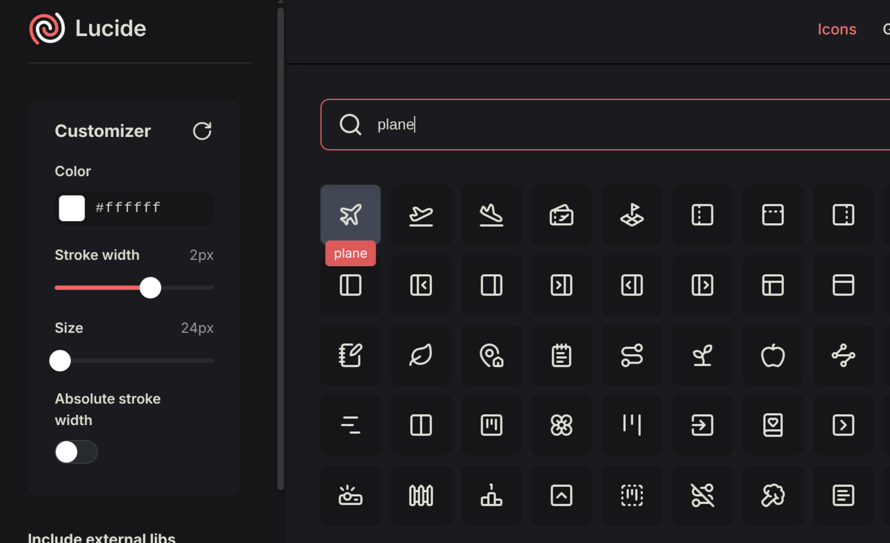
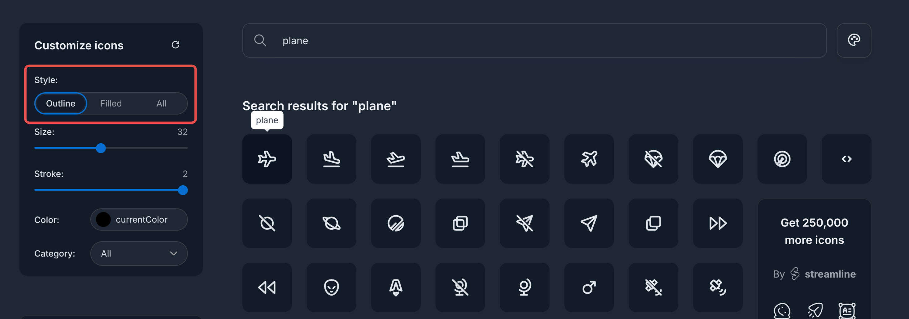

import { Demo } from "@/components/demo";

## Using the built-in icons

`AddStellarAdminUI()` registers the [Lucide](https://lucide.dev/) icons, so you can use any Lucide icon in the [`<sa-icon>`](/docs/ui/components/icon) Tag Helper. Specify the icon's name in the `name` attribute:

```razor
<sa-icon name="plane"/>
```

To find an icon's name, search the [Lucide icons page](https://lucide.dev/icons/). The name is displayed when you hover over an icon:



Names aren't case sensitive. When no icon has the name you specify, `<sa-icon>` renders a placeholder icon, so that you can see the mistake on the page.

`<sa-icon>` renders the icon as an inline `<svg>` element that uses `currentColor`, so the icon has the color and size of the text around it. See [icon](/docs/ui/components/icon) for how to change its size, color and stroke width.

## Adding an icon pack

An *icon pack* is a set of icons that you register together. Besides the Lucide icons, StellarAdmin.UI includes the [Tabler icons](https://tabler.io/icons), in two icon packs: `TablerOutlineIconPack` for the outline icons and `TablerFilledIconPack` for the filled icons.

To register an icon pack, call `AddIconPack<TIconPack>()` in `AddStellarAdminUI()`. The example below registers the outline Tabler icons:

```cs
using StellarAdmin.UI.Icons;

builder.Services.AddStellarAdminUI(ui =>
{
    ui.AddIconPack<TablerOutlineIconPack>();
});
```

The icons in the pack replace any icons already registered with the same name, including the Lucide icons.

To find a Tabler icon's name, search the [Tabler icons page](https://tabler.io/icons). The name is displayed when you hover over an icon. To display only the outline or the filled icons, use the **Style** filter.



### Keeping the names of an icon pack separate

To keep the icons of a pack from replacing icons with the same name, set a `Prefix` when you register the pack. The prefix is added to the start of each icon's name:

```cs
builder.Services.AddStellarAdminUI(ui =>
{
    ui.AddIconPack<TablerOutlineIconPack>(pack =>
    {
        pack.Prefix = "tabler:";
    });
});
```

With the prefix in the example above, you use the Tabler `plane` icon as `<sa-icon name="tabler:plane"/>`, and `<sa-icon name="plane"/>` is still the Lucide icon.

## Adding your own icons

To add an icon, call `AddIcon()` with the icon's name and an `IconDefinition`. The `IconDefinition` contains the attributes of the `<svg>` element, and the shapes that draw the icon, such as `path`, `circle` and `rect` elements. The example below adds a suitcase icon:

```cs
using StellarAdmin.UI.Icons;

builder.Services.AddStellarAdminUI(ui =>
{
    ui.AddIcon("voyager-suitcase", new IconDefinition(
        new Dictionary<string, string>
        {
            ["xmlns"] = "http://www.w3.org/2000/svg",
            ["width"] = "24",
            ["height"] = "24",
            ["viewBox"] = "0 0 24 24",
            ["fill"] = "none",
            ["stroke"] = "currentColor",
            ["stroke-width"] = "2",
            ["stroke-linecap"] = "round",
            ["stroke-linejoin"] = "round",
        },
        [
            new SvgShape("rect", new Dictionary<string, string>
            {
                ["x"] = "3", ["y"] = "7", ["width"] = "18", ["height"] = "13", ["rx"] = "2",
            }),
            new SvgShape("path", new Dictionary<string, string>
            {
                ["d"] = "M8 7V5a2 2 0 0 1 2-2h4a2 2 0 0 1 2 2v2",
            }),
            new SvgShape("path", new Dictionary<string, string> { ["d"] = "M8 7v13" }),
            new SvgShape("path", new Dictionary<string, string> { ["d"] = "M16 7v13" }),
        ]));
});
```

You then use the icon by its name:

```razor
<sa-icon name="voyager-suitcase"/>
```

<Callout type="warn">
  An icon replaces any icon already registered with the same name, including a Lucide icon.
</Callout>

To make an icon easier to find in an [icon picker](/docs/ui/components/icon-picker), pass its keywords as the third argument of the `IconDefinition` constructor, such as `["luggage", "baggage", "travel"]`. The icon picker's search matches the keywords as well as the name. The Lucide and Tabler icons include the keywords of their projects.

### Creating your own icon pack

To add more than a few icons, create an icon pack. An icon pack is a class that implements `IIconPack` and has a parameterless constructor. Its `GetIcons()` method returns the icons, by name, and its `GetSemanticIconMappings()` method returns the [semantic icons](#changing-the-icons-the-components-use) it supplies.

The example below defines an icon pack with two icons:

```cs
using StellarAdmin.UI.Icons;

public class VoyagerIconPack : IIconPack
{
    private static readonly Dictionary<string, string> SvgAttributes = new()
    {
        ["xmlns"] = "http://www.w3.org/2000/svg",
        ["width"] = "24",
        ["height"] = "24",
        ["viewBox"] = "0 0 24 24",
        ["fill"] = "none",
        ["stroke"] = "currentColor",
        ["stroke-width"] = "2",
        ["stroke-linecap"] = "round",
        ["stroke-linejoin"] = "round",
    };

    public IReadOnlyDictionary<string, IconDefinition> GetIcons()
    {
        return new Dictionary<string, IconDefinition>
        {
            ["voyager-suitcase"] = new IconDefinition(SvgAttributes,
            [
                Shape("rect", ("x", "3"), ("y", "7"), ("width", "18"), ("height", "13"), ("rx", "2")),
                Shape("path", ("d", "M8 7V5a2 2 0 0 1 2-2h4a2 2 0 0 1 2 2v2")),
                Shape("path", ("d", "M8 7v13")),
                Shape("path", ("d", "M16 7v13")),
            ]),
            ["voyager-compass"] = new IconDefinition(SvgAttributes,
            [
                Shape("circle", ("cx", "12"), ("cy", "12"), ("r", "9")),
                Shape("path", ("d", "m15.5 8.5-2 5-5 2 2-5z")),
                Shape("path", ("d", "M12 3v2")),
                Shape("path", ("d", "M12 19v2")),
                Shape("path", ("d", "M3 12h2")),
                Shape("path", ("d", "M19 12h2")),
            ]),
        };
    }

    public IReadOnlyDictionary<SemanticIconRole, string> GetSemanticIconMappings()
    {
        return new Dictionary<SemanticIconRole, string>();
    }

    private static SvgShape Shape(string name, params (string Name, string Value)[] attributes)
    {
        return new SvgShape(name, attributes.ToDictionary(a => a.Name, a => a.Value));
    }
}
```

To use the icon pack, register it with `AddIconPack<TIconPack>()`:

```cs
builder.Services.AddStellarAdminUI(ui =>
{
    ui.AddIconPack<VoyagerIconPack>();
});
```

The example below uses the two icons from the pack:

<Demo src="/demo/ui/icon-custom.html">
  <include>./components/_include/icon-custom.mdx</include>
</Demo>

## Changing the icons the components use

Some Tag Helpers render icons of their own. For example, [`<sa-pagination-ellipsis>`](/docs/ui/components/pagination#sa-pagination-ellipsis) renders an ellipsis icon. Instead of an icon name, these Tag Helpers use a *semantic icon*, an icon that an icon pack maps to a role, such as `SemanticIconRole.PaginationEllipsis`.

The icon packs map icons to the roles, and when you register an icon pack, its mappings replace the mappings of the icon packs registered before it. To keep the existing mappings, set `ImportSemanticMappings` to `false` when you register the pack:

```cs
builder.Services.AddStellarAdminUI(ui =>
{
    ui.AddIconPack<VoyagerIconPack>(pack =>
    {
        pack.ImportSemanticMappings = false;
    });
});
```

### Mapping icons in your own icon pack

To map the icons of your own icon pack to roles, return the mappings from its `GetSemanticIconMappings()` method:

```cs
public IReadOnlyDictionary<SemanticIconRole, string> GetSemanticIconMappings()
{
    return new Dictionary<SemanticIconRole, string>
    {
        [SemanticIconRole.PaginationEllipsis] = "voyager-dots",
        [SemanticIconRole.DropdownIndicator] = "voyager-caret-down",
    };
}
```

Each icon you map must be one of the icons the same pack's `GetIcons()` returns, even if an icon with that name is already registered. When it isn't, StellarAdmin.UI skips the mapping, and logs a warning when the app starts.

### Changing the icon of a single role

To change the icon of a single role, call `MapSemanticIcon()` on the `IconOptions`, with the name of a registered icon:

```cs
builder.Services.Configure<IconOptions>(icons =>
{
    icons.MapSemanticIcon(SemanticIconRole.PaginationEllipsis, "ellipsis-vertical");
});
```

When no icon is registered with the name, StellarAdmin.UI keeps the role's previous icon, and logs a warning when the app starts.

## Removing the Lucide icons

To use only your own icons, call `ClearIcons()` before you register your icon pack. `ClearIcons()` removes all the icons and mappings registered before it, including the Lucide icons.

```cs
builder.Services.AddStellarAdminUI(ui =>
{
    ui.ClearIcons();
    ui.AddIconPack<VoyagerIconPack>();
});
```

<Callout type="info">
  `ClearIcons()` also removes the semantic icon mappings. When no icon is mapped to a role, the Tag Helpers that use the role render the placeholder icon. Map your own icons to the roles, or register another icon pack that maps them.
</Callout>

## API Reference

### `AddIcon(name, iconDefinition)`

Registers an icon. The icon replaces any icon already registered with the same name. Names aren't case sensitive.

### `AddIconPack<TIconPack>()`

Creates an instance of `TIconPack`, and registers its icons and semantic icon mappings. `TIconPack` must have a parameterless constructor. The icons replace any icons already registered with the same name.

### `AddIconPack<TIconPack>(configure)`

Registers an icon pack, like `AddIconPack<TIconPack>()`, with the options you set in `configure`:

<TypeTable
  type={{
    Prefix: {
      description: "The text added to the start of the name of each icon in the pack. By default, the icons keep their names.",
      type: "string?",
    },
    ImportSemanticMappings: {
      description: "Whether the pack's semantic icon mappings replace the existing mappings.",
      type: "bool",
      default: "true",
    },
  }}
/>

### `ClearIcons()`

Removes all the icons and semantic icon mappings registered before it, including the Lucide icons.

### `IIconPack`

<TypeTable
  type={{
    GetIcons: {
      description: "Returns the icons in the pack, by name.",
      type: "IReadOnlyDictionary<string, IconDefinition>",
    },
    GetSemanticIconMappings: {
      description: "Returns the names of the pack's icons, by the semantic role they're mapped to. Return an empty dictionary if the pack doesn't map any roles.",
      type: "IReadOnlyDictionary<SemanticIconRole, string>",
    },
  }}
/>

### `IconDefinition`

<TypeTable
  type={{
    Attributes: {
      description:
        "The attributes rendered on the <svg> element, such as viewBox, fill and stroke. Attributes you specify on <sa-icon> take precedence.",
      type: "IReadOnlyDictionary<string, string>",
    },
    Shapes: {
      description: "The shapes rendered inside the <svg> element, in order.",
      type: "IReadOnlyList<SvgShape>",
    },
    Keywords: {
      description: "The words that an icon picker's search matches, besides the name. Empty by default.",
      type: "IReadOnlyList<string>",
    },
  }}
/>

### `SvgShape`

<TypeTable
  type={{
    Name: {
      description: "The name of the SVG element, such as path, circle, rect, line or polyline.",
      type: "string",
    },
    Attributes: {
      description: "The attributes rendered on the element, such as d, cx, cy or r.",
      type: "IReadOnlyDictionary<string, string>",
    },
  }}
/>
